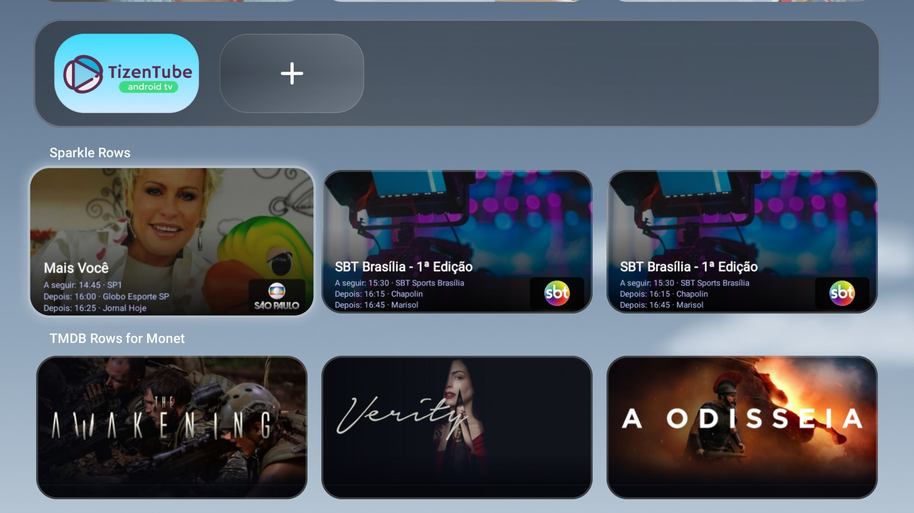
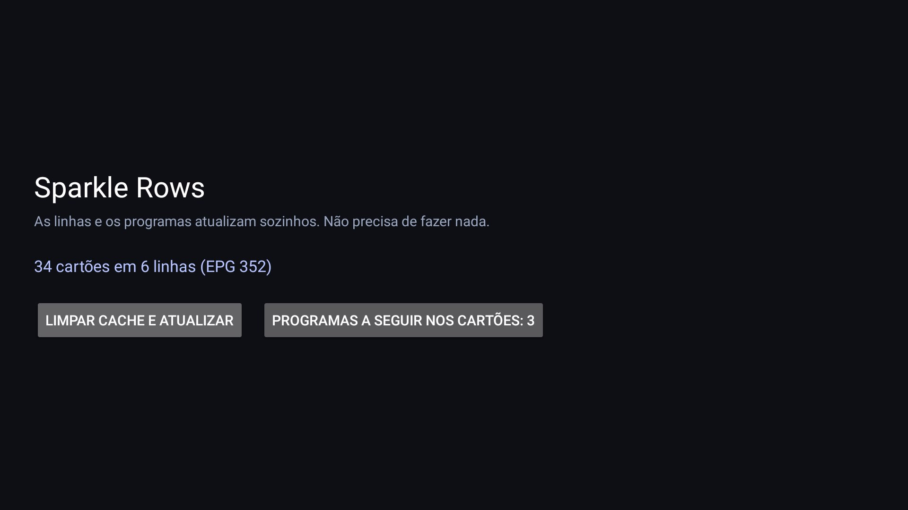

# Sparkle Rows para Monet

Un **plugin para el Monet Launcher**: convierte tu lista IPTV en filas de canales y programas.
Código abierto (MIT). Sin reproductor, sin launcher, sin lista incluida, sin cuenta.



| |
| --- |
| **La app** — estado de la sincronización y elección de los próximos programas |
|  |

## Cómo funciona

1. Instala el APK y pega **una sola vez** el enlace de tu **lista (M3U)**. El enlace del EPG viene
   de la cabecera `x-tvg-url` de la lista; si no la tiene, puedes pegarlo a mano.
2. **Guardar y publicar.** La app publica una fila por grupo y las mantiene actualizadas sola.
3. Añádela en **Monet → Personalizar → fila de media → Sparkle Rows**.

Después ya no se pide nada más: la app vuelve a sincronizar cuando termina el programa actual.

## Tarjetas

- **Tarjetas 16:9** creadas en el dispositivo: imagen del programa, nombre del programa y sello con
  el logo del canal.
- **Próximos programas** — la tarjeta muestra lo que viene después, tomado del EPG: elige **ninguno,
  1, 2 o 3** programas, cada uno con la hora de inicio.
- **Un toque** abre el canal en Sparkle (`se.hedekonsult.sparkle`), ya en el canal correcto.

## Idiomas

La interfaz sigue el idioma del televisor: **español, inglés, portugués y francés**.
Las fechas y horas usan el formato del sistema (12 h o 24 h).

## Instalar

Descarga `sparkle-rows-for-monet-*.apk` de las [Releases](../../releases) e instálala en un Android TV
(8.0+):

```bash
adb install -r sparkle-rows-for-monet-1.1.apk
```

## Compilar

```bash
./gradlew :app:assembleRelease   # R8
./gradlew :app:testDebugUnitTest
```

Firma: `release.keystore` + `keystore.properties` (ambos fuera de Git); sin ellos la release usa la
clave de debug. Guarda el keystore: los APK futuros deben mantener la misma firma.

## Notas

- Hasta 10 filas, 30 tarjetas por fila.
- Todo se queda en el dispositivo; la lista y el EPG solo se descargan.
- El enlace de la lista es un secreto: nunca lo compartas ni lo subas a Git.
- Probado con **Monet 1.1** y **Sparkle** en Android TV.

## Licencia

[MIT](LICENSE).
