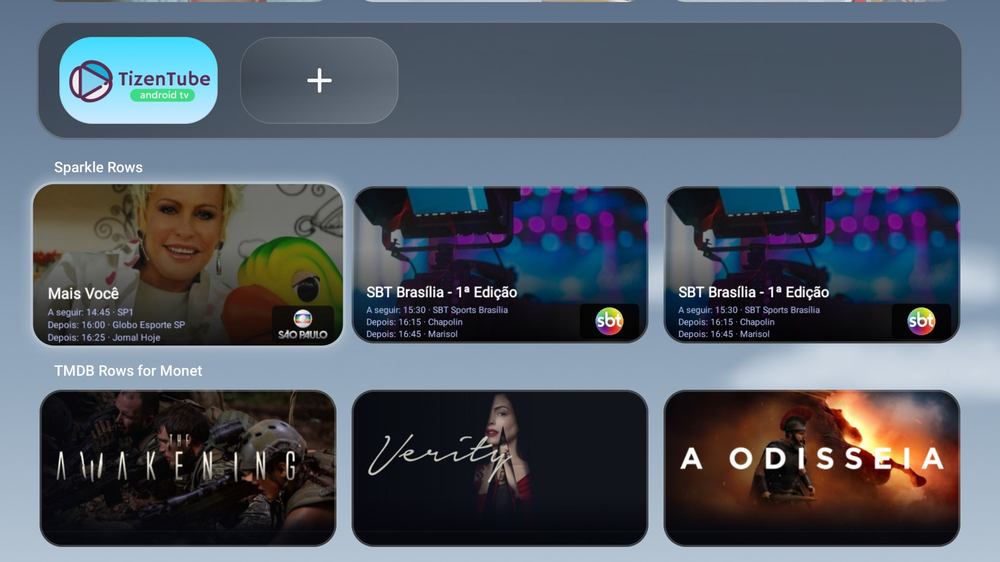
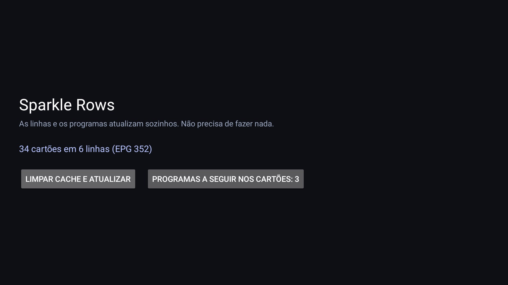

# Sparkle Rows for Monet

A **plugin for the Monet Launcher**: it turns your IPTV playlist into rows of channels and
programs. Open source (MIT). No player, no launcher, no playlist included, no account.



| |
| --- |
| **App** — sync state and the cards setting |
|  |

## How it works

1. Install the APK and paste your **playlist (M3U)** link once. The EPG link is read from the
   `x-tvg-url` header of the playlist; you can paste one if the playlist has none.
2. **Save and publish.** The app publishes one row per group and keeps them updated on its own.
3. Add it in **Monet → Personalize → media row → Sparkle Rows**.

From then on nothing is asked again: the app re-syncs when the current program ends.

## Cards

- **16:9 cards** made on the device: program image, program name, channel logo badge.
- **Next programs** — the cards show what is on next, taken from the EPG: choose **none, 1, 2 or 3**
  programs, each with the time it starts.
- **One tap** opens the channel in Sparkle (`se.hedekonsult.sparkle`), already on the right channel.

## Languages

The interface follows the language of the TV: **English, Português, Español, Français**.
Dates and times use the system format (12 h or 24 h).

## Install

Download `sparkle-rows-for-monet-*.apk` from [Releases](../../releases) and install on an Android TV
(8.0+):

```bash
adb install -r sparkle-rows-for-monet-1.1.apk
```

## Build

```bash
./gradlew :app:assembleRelease   # R8, signed with the debug key
./gradlew :app:testDebugUnitTest
```

## Notes

- Up to 10 rows, 30 cards per row.
- Everything stays on the device; the playlist and the EPG are only downloaded.
- The playlist link is a secret: never share it or commit it.
- Tested with **Monet 1.1** and **Sparkle** on Android TV.

## License

[MIT](LICENSE).
