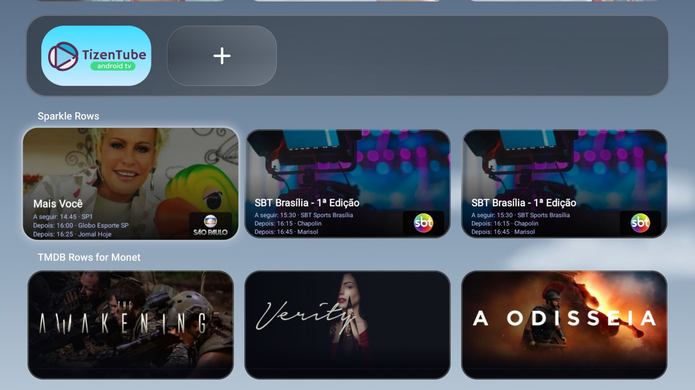
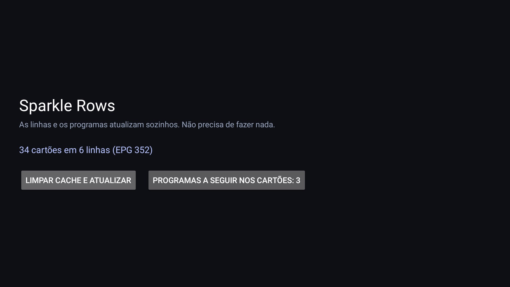

# Sparkle Rows para o Monet

Um **plugin para o Monet Launcher**: transforma a sua lista IPTV em linhas de canais e programas.
Código aberto (MIT). Sem player, sem launcher, sem lista incluída, sem conta.



| |
| --- |
| **A app** — estado da sincronização e escolha dos programas a seguir |
|  |

## Como funciona

1. Instale o APK e cole **uma vez** o link da sua **lista (M3U)**. O link do EPG vem do cabeçalho
   `x-tvg-url` da lista; se não tiver, pode colá-lo à mão.
2. **Guardar e publicar.** A app publica uma linha por grupo e mantém-nas atualizadas sozinha.
3. Adicione em **Monet → Personalizar → linha de media → Sparkle Rows**.

Depois disso nunca mais é pedido nada: a app volta a sincronizar quando o programa atual termina.

## Cartões

- **Cartões 16:9** desenhados no aparelho: imagem do programa, nome do programa, selo com o logo do canal.
- **Programas a seguir** — o cartão mostra o que vem depois, tirado do EPG: escolha **nenhum, 1, 2 ou
  3** programas, cada um com a hora a que começa.
- **Um toque** abre o canal no Sparkle (`se.hedekonsult.sparkle`), já no canal certo.

## Idiomas

A interface segue o idioma da TV: **português, inglês, espanhol e francês**.
As datas e horas usam o formato do sistema (12 h ou 24 h).

## Instalar

Descarregue `sparkle-rows-for-monet-*.apk` das [Releases](../../releases) e instale numa Android TV
(8.0+):

```bash
adb install -r sparkle-rows-for-monet-1.1.apk
```

## Compilar

```bash
./gradlew :app:assembleRelease   # R8, assinado com a chave de debug
./gradlew :app:testDebugUnitTest
```

## Notas

- Até 10 linhas, 30 cartões por linha.
- Tudo fica no aparelho; a lista e o EPG só são descarregados.
- O link da lista é um segredo: nunca o partilhe nem o envie para o Git.
- Testado com o **Monet 1.1** e o **Sparkle** numa Android TV.

## Licença

[MIT](LICENSE).
